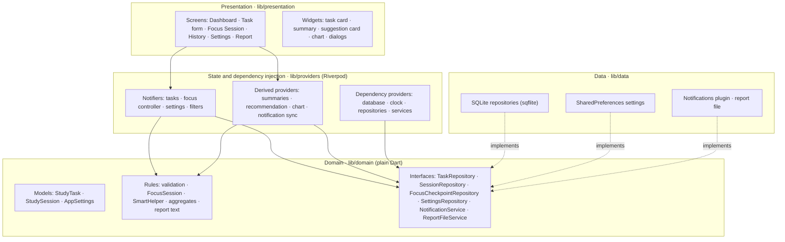

# FocusQuest Architecture

FocusQuest is an offline Flutter app in three layers: **presentation**, **domain** and **data**. Riverpod connects the layers and supplies their dependencies. The domain layer is plain Dart with no Flutter widgets, so the rules can be tested in isolation.

## 1. Layers

Arrows point from the caller to what it depends on. The data layer implements the domain interfaces, and nothing in the domain depends on Flutter, SQLite or the plugins.

| Folder | Contents |
|---|---|
| `lib/domain/models` | `StudyTask`, `StudySession`, `SessionRecord` (a session joined with its task's title and subject), `AppSettings` |
| `lib/domain/validation` | Field limits and validators, shared by forms, repositories and the helper |
| `lib/domain/focus` | `FocusSession`: the session state machine |
| `lib/domain/helper` | `SmartHelper`: scoring, explanation and baseline |
| `lib/domain` | `aggregates`, `history`, `insights` (chart totals), `report/` (report text), `clock` |
| `lib/domain/repositories`, `lib/domain/services` | Interfaces the data layer implements |
| `lib/data/database` | Schema, migration and row mapping |
| `lib/data/repositories`, `lib/data/services` | SQLite, SharedPreferences, notifications and report-file implementations |
| `lib/providers` | Riverpod providers and notifiers |
| `lib/presentation` | Screens, widgets, theme and formatting |

## 2. State ownership (Riverpod)

| Provider | Type | Owns |
|---|---|---|
| `databaseProvider`, `notificationServiceProvider` | `Provider` | Created in `main` before the app starts and supplied as overrides |
| `clockProvider` | `Provider` | The current time. Tests replace it. |
| `taskRepositoryProvider`, `sessionRepositoryProvider`, `focusCheckpointRepositoryProvider`, `settingsRepositoryProvider`, `reportFileServiceProvider` | `Provider` | Repository and service instances |
| `dataRevisionProvider` | `Notifier<int>` | A counter bumped after every successful task or session write |
| `tasksProvider` | `AsyncNotifier` | The task list, plus create, save, delete and count-sessions actions |
| `focusControllerProvider` | `AsyncNotifier` | The focus session and its checkpoint |
| `settingsProvider` | `AsyncNotifier` | Saved settings |
| `selectedTabProvider`, `selectedTaskIdProvider`, `statusFilterProvider`, `historyFilterProvider`, `availableMinutesProvider`, `sessionLengthProvider` | `Notifier` | Screen selections and filters |
| `historyRecordsProvider`, `historySummaryProvider`, `weeklyStudyMinutesProvider`, `dailyMinutesProvider`, `recommendationProvider`, `subjectsProvider` | `FutureProvider` | Values derived from saved data |
| `reminderSyncProvider`, `sessionAlertSyncProvider` | `Provider` | Keep scheduled notifications in step with settings and the session |

**Loading, error and success.**
- **Every load shows its state.** Each async value appears as a labelled loading view, an error message with **Retry** (`ref.invalidate`), or the data.
- **Riverpod's automatic retry is turned off** (`retry: null` in `main`), so failures are shown to the student instead of being retried silently.
- **Data stays visible while it refreshes.** Screens match `AsyncValue(:final value?)` rather than only `AsyncData`, so a reload after a change keeps the current data on screen instead of flashing a spinner. Without this, a reload during the completion animation would interrupt it.
- **Write errors reach the screen.** Notifier write methods let errors propagate, so forms and dialogs keep the student's input and offer Retry. On success the notifier bumps `dataRevisionProvider`.

## 3. Repository interfaces and dependency injection

| Interface (domain) | Implementation (data) |
|---|---|
| `TaskRepository` | `SqliteTaskRepository` |
| `SessionRepository` | `SqliteSessionRepository` |
| `FocusCheckpointRepository` | `SqliteFocusCheckpointRepository` |
| `SettingsRepository` | `PrefsSettingsRepository` |
| `NotificationService` | `LocalNotificationService` |
| `ReportFileService` | `LocalReportFileService` |

- **Screens and notifiers depend only on the interfaces,** obtained through providers.
- **`main` opens the database, initialises notifications** (a failure there doesn't stop the app) and passes both in as provider overrides.
- **Tests override the same providers** with in-memory fakes and a controllable clock (`test/support/`).
- **The SQLite and file implementations** are tested against real SQLite and temporary files.

## 4. Persistence

**SQLite** (`focus_quest.db`, schema version 2):

| Table | Purpose and rules |
|---|---|
| `study_tasks` | `AUTOINCREMENT` ids (never reused). CHECK constraints mirror the validation: title 1–60, subject 1–40, priority 1–3, estimate 5–120, status `pending`/`completed`, `updated_at ≥ created_at`. |
| `study_sessions` | `task_id` references `study_tasks` with `ON DELETE CASCADE`. Duration 1–120. `ended_at ≥ started_at`. Status `completed`/`ended_early`/`manual`. Indexes on `(task_id, started_at)` and `started_at` for History filters. |
| `active_session` | One row (`id = 1`) holding the in-progress focus session: task, state, start, active milliseconds, target, last resume, and `finished_at`. Cascades with its task. |

- **Foreign keys** are switched on in `onConfigure`. Timestamps are stored as milliseconds since the epoch, and all queries use parameters.
- **Version 2 added `active_session.finished_at`.** `onUpgrade` adds the column, so existing version-1 databases keep their data.
- **Deleting a task** runs in one transaction: refuse if it has an active checkpoint, count its sessions for the confirmation, then delete (the cascade removes the sessions).
- **Settings** use SharedPreferences: `session_minutes`, `reminders_enabled` (both from the proposal), plus `reminder_minutes`, `reduced_motion` and `theme_mode`. Invalid stored values fall back to defaults.
- **The text report** is written to the app's documents folder as `focusquest_study_summary.txt`, then read back for the preview.

## 5. Cross-screen updates

Every successful write to tasks or sessions bumps `dataRevisionProvider`, from the task form, the task menu, Focus Save or the History dialogs. Read providers (task list, History records, totals, weekly minutes, chart, recommendation, subjects) watch it, so the Dashboard, History and Focus screens all reload after a change made anywhere. Settings changes propagate through `settingsProvider`; for example, the focus target, the theme and reduced motion follow it.

## 6. Focus timer and recovery

- **`FocusSession` is immutable and time-based.** Each action (start, pause, resume, finish, reset) takes the current time and returns a new state. Active time is calculated from saved timestamps: time accumulated before the last resume, plus the current running stretch. Paused time is never counted, a clock moved backwards adds nothing, and active time is capped at the target.
- **Checkpoint first.** `FocusController` writes the new state to `active_session` *before* updating what's on screen, so a restart restores exactly what was shown. At startup the controller loads the checkpoint if there is one; otherwise the session is Ready for the selected task.
- **The once-a-second ticker only redraws.** It runs only while the session is running, is cancelled on dispose, and opens the review when the target is reached. If the app was closed past the target, the record ends at the moment the target was reached.
- **Saving happens once.** One transaction inserts the session record and deletes the checkpoint, and only if the checkpoint for that exact start time still exists. A repeated or concurrent Save finds nothing and is ignored. A failed Save leaves the checkpoint in place, so Retry is safe.
- **App lifecycle.** An `AppLifecycleListener` re-saves the checkpoint when the app is hidden. On resume it refreshes the countdown and opens the review if the target passed while the app was away.

## 7. Lifecycle cleanup

- **Disposed when screens close:**
  - text controllers and focus nodes in forms
  - the `AnimationController` and pause timer of the completion animation
  - the focus ticker
  - `AppLifecycleListener`s
- **Screens check `mounted`** after every `await` before using their context.
- **Notifiers check `ref.mounted`** before writing state after an `await`.
- **Platform failures are contained.** Notification calls are wrapped so a platform failure can't break the rest of the app.

## 8. Background processing

- **Work runs on a background isolate:** History totals and the report text are prepared with `compute`, so long histories don't block the UI.
- **Swappable for tests:** both functions are pure and provided through providers (`historyAggregatorProvider`, `reportBuilderProvider`), so widget tests can run them synchronously. Unit tests check that the isolate path gives the same result.
- **No assumed background execution:** session recovery relies on persisted timestamps, not on code running while the app is closed.

## 9. Notifications

`reminderSyncProvider` and `sessionAlertSyncProvider` react to settings, permission and session changes:
- they schedule the daily reminder while reminders are on and permission is granted
- they schedule the session-end alert while a session runs
- they cancel each otherwise

Permission is requested when the reminder is switched on and re-checked when the app resumes. Scheduling is inexact, so no exact-alarm permission is needed.

## 10. Design alternatives and trade-offs

| Decision | Alternative | Why this choice |
|---|---|---|
| Three layers with interfaces | Single layer: widgets call the database and timers directly | More files, but rules such as timing, scoring and validation are testable without a device. Storage can be faked. Each screen stays small. A single-layer version would have to be tested through the UI and would duplicate rules across screens. |
| Revision counter for refresh | Repositories expose `Stream`s that watch the database | A single counter is simple and keeps every screen consistent. The cost is that any write reloads every watching provider, which is cheap at this data size. |
| Timestamp-based timer plus checkpoint | A ticking timer counting seconds in memory | Survives restarts and background suspension with no background service. The ticker only redraws. |
| Checkpoint in SQLite | SharedPreferences | Saving the record and clearing the checkpoint happen in one transaction, which prevents duplicate records. Matches proposal §8. |
| No automatic retry | Riverpod's default automatic retry | Students see failures and decide to retry, as the wireframes require. |
| Chart from plain widgets | A charting package | No new dependency, full control over accessibility labels and theming. Less flexible for future chart types. |
| Inexact notification scheduling | Exact alarms | Avoids Android's special "Alarms & reminders" permission. Alerts may be a little late. |

## 11. How the architecture supports testing

- **Domain rules** are pure functions or immutable classes, unit-tested with fixed times: validation, focus states, helper scoring, aggregates, chart days, report text.
- **Repositories** are tested against real SQLite on the host, including constraints, cascade, transactions and the v1→v2 upgrade.
- **Notifiers** are tested with `ProviderContainer`s and real or fake repositories, including simulated restarts.
- **Widget tests** pump the whole app with fakes and a controllable clock, so timing behaviour (pauses, the 7-day window, reaching the target) is checked exactly.
- **Integration tests** run on a device with real storage. See [docs/TEST_REPORT.md](docs/TEST_REPORT.md) and [COVERAGE.md](COVERAGE.md).
